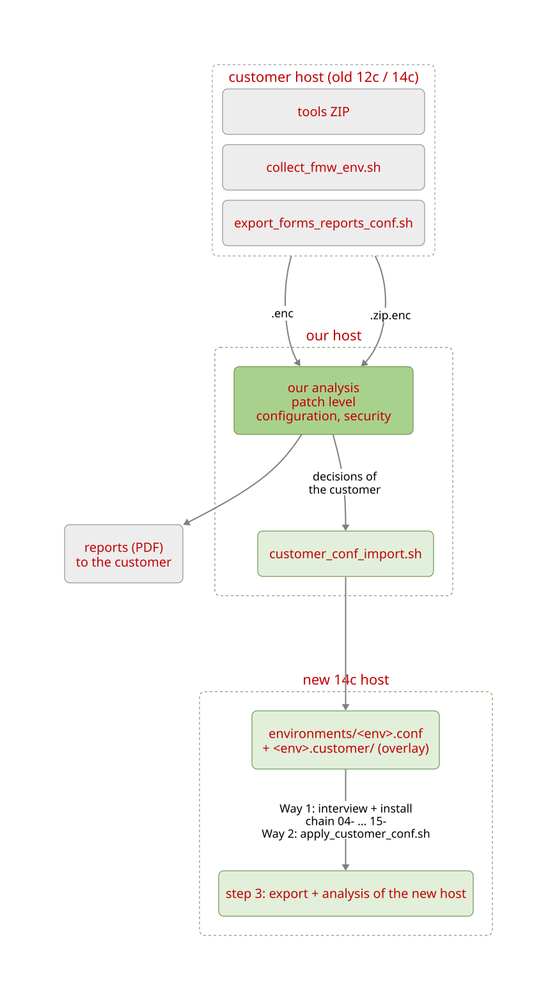

# Moving a customer environment to Forms & Reports 14c

How the configuration of an existing customer environment (12c or 14c)
reaches a 14c environment built with the IHateWeblogic library, and how the
result is checked. The process has three steps:

| # | Step | Phases below |
|---|---|---|
| 1 | **Extract and analyse data**: the customer gets a report of their current environment | A, B |
| 2 | **Build the new environment with the customer's master data**: Way 1 (preferred) or Way 2 | C1, C2 |
| 3 | **Analyse again and harden security**: the same report for the new environment, before / after | D |

The scripts themselves are described elsewhere – this document is the
workflow:
- **collect / export / analysis:** [70-Customer-Projects/tools/README.md](../../70-Customer-Projects/tools/README.md);
- **importer and overlay (spec of the scripts):** [17-customer_conf_import.md](17-customer_conf_import.md);
- **first visit at the customer (German):** [Start_beim_Kunden_kochbuch_de.txt](../../70-Customer-Projects/Start_beim_Kunden_kochbuch_de.txt).

Status 2026-11-06: both ways have run live at a customer. Way 2: import, two
customer Reports servers, old default server removed (2026-11-05). Way 1: new
build with the import before the interview (reported 2026-11-06).

---

## 1. Which way

| Situation | Way | Why |
|---|---|---|
| New 14c host, not installed yet | **Way 1 – preferred** | The customer values are in the conf **before** the interview and the install chain. `13-` creates the customer's Reports servers directly, `14-` writes the customer sections and jars at the first run. There is no default server to remove, and no second restart cycle. |
| 14c environment already built with the library (e.g. with `repserver01`) | **Way 2** | The overlay is applied afterwards with `07-Maintenance/apply_customer_conf.sh`; the default servers are removed with `13- --remove-server`. |
| 14c environment **not** built with the library | – | Not covered. The scripts expect the library's conf, layout and templates. |

**So: collect at the start of the project, not when the new host is ready.**
The export of the old environment is the master data of the new build.


<sub>Quelle: [diagrams/transfer-flow.prompt](diagrams/transfer-flow.prompt) · [D2](diagrams/transfer-flow.d2)</sub>

<details><summary>ASCII-Version</summary>

```ascii name=transfer-flow
 customer host (old 12c / 14c)          our host                              new 14c host
 ─────────────────────────────          ────────                              ────────────
 tools ZIP                              our analysis               ─┐
 collect_fmw_env.sh  ── .zip.enc ──▶      patch level               ├─▶ reports (PDF)
 export_forms_reports_conf.sh ─.enc─▶     configuration, security  ─┘   to the customer
                                              │ decisions of the customer
                                              ▼
                                        customer_conf_import.sh ──▶ environments/<env>.conf
                                                                    + <env>.customer/ (overlay)
                                                                          │
                                                        Way 1: interview + install chain 04- … 15-
                                                        Way 2: apply_customer_conf.sh
                                                                          ▼
                                                        step 3: export + analysis of the new host
```

</details>

---

## 2. Phase A – at the customer (step 1)

As the software owner (`oracle`), from the unpacked tools ZIP in
`$ORACLE_BASE/tools`. The first visit is described step by step in
[Start_beim_Kunden_kochbuch_de.txt](../../70-Customer-Projects/Start_beim_Kunden_kochbuch_de.txt).

```bash
cd $ORACLE_BASE/tools
./collect_fmw_env.sh -t $ORACLE_BASE/install          # patch level, OS, Java, web tier
./export_forms_reports_conf.sh -t $ORACLE_BASE/install  # configuration + load profile
```

- **Read-only:** both scripts change nothing on the host.
- **Encrypted:** both ask for a passphrase at the start and write a
  `.zip.enc` with a `.sha256` next to it. Send the passphrase separately from
  the file.
- **Passwords never leave the host in clear text.** The export removes or
  masks stored logins; the importer takes none of them over.
- **Secured Reports server:** with `--rw-auth <user>` the export also asks
  `getserverinfo` / `showjobs` (password asked hidden).
- **Load profile:** the export counts the application starts of the last 90
  days. This is the basis of the "unused section" decisions.

---

## 3. Phase B – analysis and customer report (step 1)

On our side: the analysis scripts are not part of this repository (private
repository, not needed at the customer). They turn the two archives into two
reports:

| Report | Content | Light |
|---|---|---|
| `patch_analyse_<customer>_<date>.md` | patch level against the cycle, Java, web tier, how to patch | patch light (cycle met / partly / not) |
| `fmw_forms_reports_status_<customer>_<date>.md` | the whole configuration, the 14c target mapping, findings | security light per area, overall = worst area |

The reports contain host names and paths. They go **only** to the customer
(as PDF).

### To clarify with the customer **before** the build

| Point | Where it shows | Why it matters |
|---|---|---|
| Server names per environment (test / production naming) | status report, Reports section | They become `REPORTS_SERVER_INSTANCES`; a typo creates a server without the customer values. |
| Unused `formsweb.cfg` sections / env files | decisions `SECTION_UNUSED`, `ENV_UNUSED` | Take them over or drop them. |
| Module directories (more than one) | `PATH_KEPT` / `PATH_MAPPED` | The main one becomes `FORMS_CUSTOMER_DIR`; the others are kept as they are. |
| Microsoft fonts | `FONT_MS` | Not copied (licence) – Carlito / Liberation instead, or a customer licence. |
| Mail server for Reports (`destype=mail`) | `rwserver.conf` `mailServer` | Often an unset Oracle placeholder at the customer, too. |
| TNS aliases | export `tns.csv` | The new `TNS_ADMIN` needs a `tnsnames.ora`; the smoke test `15-` also needs an alias for the test DB service. |
| Code signing of the customer jars | jar table (signer, expiry) | Customer PKI or our own CA; a timestamp authority (`FORMS_SIGN_TSA_URL`) for signatures that outlive the certificate. |
| Outbound connections / firewall | collector web tier, `egress_check.sh` | Proxy, TSA, mail server, external DTDs. |

---

## 4. Phase C1 – Way 1: new build with the customer's data (step 2, preferred)

### When does the interview run? (no chicken-and-egg problem)

The order on the new host is: **clone → import → interview → install
chain**. The importer runs *before* the interview and needs nothing from it:
- **Placeholders:** the overlay holds no paths of the new host, only
  `##ORACLE_HOME##`, `##DOMAIN_HOME##`, `##FORMS_CUSTOMER_DIR##`,
  `##WLS_SERVER_FQDN##` …. `14-` fills them in much later from the then
  complete conf.
- **The new conf:** the importer writes `environments/<env>.conf` with the
  import block only. When there is no `environment.conf` yet, it links that
  file as `environment.conf`.
- **The interview continues this conf:** the imported keys are shown as
  `[kept]`, and the customer's Reports servers (`REPORTS_SERVER_INSTANCES`)
  become `REPORTS_SERVER_NAMES` / `REPORTS_SERVER_NAME` – one list. It asks
  only for what the export cannot know: host values (`ORACLE_BASE`,
  `DOMAIN_HOME`, the public `WLS_SERVER_FQDN`, RCU database), the decisions
  and the passwords. It writes its block into the same file.

| Order | Step | As |
|---|---|---|
| 1 | `git clone` of the library on the new host (see [09-Install/README.md](../README.md), "Setup") | oracle |
| 2 | copy the export (`.zip.enc`) to the new host; `customer_conf_import.sh --env <env>` dry run, then `--apply` | oracle |
| 3 | `01-setup-interview.sh --apply` | oracle |
| 4 | phase 0 (root scripts) and the install chain | root / oracle |

If an `environment.conf` already exists (e.g. a test run of the interview),
the importer leaves it alone and prints the `ln -sfn` command. Then either
link it to the new conf, or import with `--env` set to the conf the link
points to.

```bash
# 1. import: creates environments/<env>.conf with the import block + the overlay
./00-Setup/customer_conf_import.sh -i ihw_export_<host>_<ts>.zip.enc --env <env>            # dry run
./00-Setup/customer_conf_import.sh -i ihw_export_<host>_<ts>.zip.enc --env <env> --apply

# 2. interview: the imported values are shown as [kept]; it asks for the
#    host values, the decisions and the passwords
./09-Install/01-setup-interview.sh
```

3. **Check the Reports server list in the conf** before the install chain.
   The interview takes it from the import; all three keys must name the
   customer's servers, without duplicates:

   ```bash
   grep -nE '^REPORTS_SERVER|^\s+"' 00-Setup/environments/<env>.conf
   # REPORTS_SERVER_NAME="repsrv_iso"                 default server (cgicmd.dat, 15-, status tools)
   # REPORTS_SERVER_NAMES=( "repsrv_iso" "repsrv_utf" )
   # REPORTS_SERVER_INSTANCES="repsrv_iso repsrv_utf"   13- creates exactly these
   ```

4. **Install chain** as in [09-Install/README.md](../README.md): `02-` … `15-`.
   `13-`, `14-` and `14b-` read the overlay (`CUSTOMER_CONF_DIR`).
5. **Autostart:** `30-configure_autostart.sh --apply`, **after** `13-`. It
   writes the Reports servers of `config.xml` into the control scripts.
6. **Validate:** `90-oracle_validate.sh`, then phase D.

---

## 5. Phase C2 – Way 2: environment already built with the library (step 2)

The sequence as it ran live on 2026-11-05. Send the log of every step
(`log/<date>/…`); the path is printed at the end of each run.

| # | Command | Log |
|---|---|---|
| 1 | `./00-Setup/customer_conf_import.sh -i <export>` (dry run), then with `--apply` | `customer_conf_import_*.log` (with the full decision table) |
| 2 | fix the server list in the conf (see Way 1, point 3) – the importer keeps keys that are already set and only warns | – |
| 3 | `./07-Maintenance/backup_config.sh --apply` | `backup_config_*.log` |
| 4 | `./07-Maintenance/apply_customer_conf.sh` (dry run) | `apply_customer_conf_*.log` (one file with every step) |
| 5 | `./07-Maintenance/apply_customer_conf.sh --apply` | same; runs `14b-` → `14-` → `13-` → `30-` (if the autostart misses a server) → `stop-all` / `start-all` → waits for every Reports server (`getserverinfo`, `IHW_REPORTS_READY_WAIT`, default 240 s) → `15-` → `90-` |
| 6 | `./01-Run/startStop.sh stop <old server> --apply` | `startStop_*.log` |
| 7 | `./09-Install/13-oracle_setup_reports.sh --remove-server <old server>` (dry run), then with `--apply` | `reports_setup_*.log` (WLST output, component list before / after) |
| 8 | `./09-Install/30-configure_autostart.sh --apply` | `configure_autostart_*.log` |

- **Before `--apply`**, the section "Reports server names" of step 4 must
  show OK for every customer server. It warns when:
  - a server of the overlay is not in the list;
  - a server of the list has no overlay values (typo);
  - the two lists differ;
  - `REPORTS_SERVER_NAME` is not in the list.
- **`apply_customer_conf.sh --apply --no-restart`** stops after `13-` (and
  `30-`). The restart is then done by hand.
- **The old default server** keeps running until step 6 – it does not
  disturb the new ones (other name, same port).
- **Forms client bundle (FSAL shortcut):** Way 2 keeps the library's
  `FORMS_CLIENT_CONFIG` / `FORMS_CLIENT_FORM` (test form). Once a customer
  section works, set it in the conf and run
  `09-Install/40-oracle_forms_client_bundle.sh --apply`. It checks that the
  section exists, and that a WebUtil section has `baseSAAfile=webutilsaa.txt`.
  Way 1 takes the customer section with the most application starts
  automatically.

---

## 6. Phase D – analyse again and harden security (step 3)

The loop is closed with the same tools: the new 14c host is exported and
analysed like the old one. The customer gets the same report for the new
environment, before / after.

```bash
# on the new 14c host (tools ZIP or repository)
./export_forms_reports_conf.sh -t $ORACLE_BASE/install
./collect_fmw_env.sh -t $ORACLE_BASE/install
# then on our side: both archives through the analysis, as in step 1
```

- **Target:** security light green, or yellow with a documented reason per
  finding. Patch light green for the current cycle.
- **Typical points from a 12c environment** and where they are solved:

| Finding | Solved by |
|---|---|
| admin consoles (`/console`, `/em`) reachable through the web tier | Nginx template of the library: only from `ADMIN_IP_RANGE` ([04-root_nginx.md](04-root_nginx.md#admin-network-admin_ip_range--optional)), every WebLogic socket on loopback ([80-oracle_security.md](80-oracle_security.md)) |
| open forward proxy (`proxy_pass $http_…`) in the old web tier | not taken over – the library's Nginx has fixed targets |
| `webcommandaccess` L2, Reports web commands open | [81-reports_rwservlet_security.md](81-reports_rwservlet_security.md) – the importer sets L1 |
| WebUtil `transfer.appsrv.accessControl=FALSE` | importer rule `WEBUTIL_ACCESS` (TRUE, directories below `FORMS_TMP`) |
| stored DB logins (`userid=`, `cgicmd.dat`) | removed by the importer; `cmdkey` with `RepRunner` |
| `allow_debug=true`, `restrictedURLparams` | importer rules `FORMS_DEBUG`, `FORMS_URLPARAMS` |
| unsigned / SHA-1 signed customer jars | `14-` signs them; set `FORMS_SIGN_TSA_URL` |
| IPv6 active, slow logins | `09-Install/01-root_os_baseline.sh --apply` (as root) |
| bundled JDK of the Oracle Home (`oracle_common/jdk`) | known product gap – patch analysis section 5 |

- **Closing check:** `./09-Install/90-oracle_validate.sh`
  ([90-oracle_validate.md](90-oracle_validate.md)); the project-wide state is
  in the root README, "Security & Patch Status".

---

## 7. Pitfalls found in the live run (2026-11-05)

| Symptom | Cause | Now |
|---|---|---|
| `13-` would create only one of two customer servers | the conf holds **two** server lists (`REPORTS_SERVER_NAMES` of the interview, `REPORTS_SERVER_INSTANCES`); one was incomplete, one had a typo | `apply_customer_conf.sh` "Reports server names": both lists shown, WARN on a difference, on a typo and on an overlay server missing from the list |
| `14b-` writes `cgicmd.dat` for the old server | `REPORTS_SERVER_NAME` still the old default server | WARN in the same section |
| `REPORTS_BROADCAST_PORT` differs from the old environment | the new servers have the **same names** as the old ones – the same port in the same network would mix them up (multicast discovery) | keep the library's port (importer: INFO "kept") |
| `13-` FAIL "Multicast prerequisites failed" right after creating the servers | WLST creates a new server with Oracle's default port 14021; the check ran before `13-` aligned it | the check runs after the port update |
| `start-all` / systemd do not start the new servers | `30-` writes the system components into its control scripts at configure time | lib `autostart_drift`: `startStop.sh` warns and starts / stops them directly, `13-` warns, `apply_customer_conf.sh` re-renders with `30- --apply` |
| `15-` REP-51002 right after `start-all` although the server runs | the Node Manager reports "started" minutes before the Reports server accepts requests (about 3 min) | `apply_customer_conf.sh` waits for `getserverinfo` |
| `rwserver_status.sh` OK with an empty "Server Info" | HTTP 200 without `<serverInfo>` counted as reachable | FAIL with the start of the answer |
| `14-` dry run OK, but `--apply` would fail for the customer jars | the keystore check covered only `jacob.jar` | the check counts the customer jars of the overlay |
| 14 WARN "signature without timestamp" | `FORMS_SIGN_TSA_URL` empty | set it when the host may reach a TSA, then `14- --apply --resign` |
| `15-` FAIL "No alias with SERVICE_NAME=…" | no `tnsnames.ora` in `TNS_ADMIN` | create it before the smoke test |
| logins of the Reports servers take 1.6–2.6 s (test host: 60 ms) | suspected: IPv6 still active – `localhost` is tried as `::1` first (not confirmed yet) | `01-root_os_baseline.sh --apply`, then compare "Avg auth time" in `rwserver_status.sh` |

---

## 8. Verification

```bash
./01-Run/rwserver_status.sh --server <each server>   # server info, engines; NLS of the engines = overlay value per server
./02-Checks/reports_network_scan.sh                  # every server on the library's port, nobody else
$ORACLE_BASE/admin/<domain>/ctrl/fmw_ctl.sh status   # every component RUNNING under the Node Manager
./09-Install/15-deploy-test-report-forms_template.sh --apply   # test report as PDF
./09-Install/90-oracle_validate.sh
```

Then:
- **Forms:** log in with the customer's own modules, one per configuration
  section that is taken over.
- **Reboot:** one reboot of the host – systemd must bring back every
  component, including the customer's Reports servers.

---

## 9. Rollback

| What | Backup | Back |
|---|---|---|
| configuration files of the domain | `07-Maintenance/ConfigBackup/<ts>/` (`backup_config.sh`) | `07-Maintenance/restore_config.sh --apply` |
| conf of the environment | `00-Setup/environments/<env>.conf.bak_<ts>` (importer) | copy back |
| overlay | `<env>.customer.bak_<ts>` (a repeated import) | rename back |
| removed Reports server | `ConfigBackup/remove_reports_<name>_<ts>/` (`config.xml`, component directories, `servers/<name>`) | re-create it with `13-` (add the name to `REPORTS_SERVER_INSTANCES`) – the backup holds its old configuration |
| autostart control scripts | `$ORACLE_BASE/admin/<domain>/ctrl/backup_<ts>/` | `30-configure_autostart.sh --apply` renders them again from `config.xml` |
