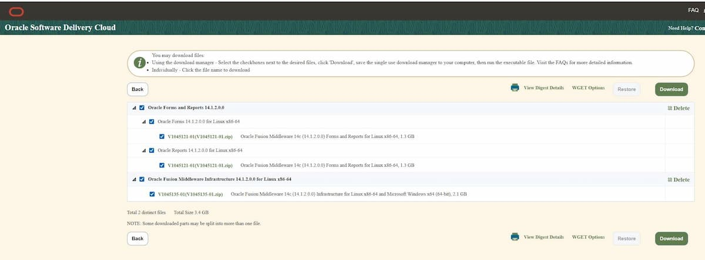

# Step 1b – 04-oracle_pre_download.sh

**Script:** `09-Install/04-oracle_pre_download.sh`
**Runs as:** `oracle`
**Phase:** 1 – Pre-Install

---

## Download Sources

FMW 14.1.2 software comes from **two different sources** — the script handles both:

| Source | What | How |
|---|---|---|
| **eDelivery** (Oracle Software Delivery Cloud) | Base installers (V\*.zip) | Manual download, then unzip |
| **MOS** (My Oracle Support) | OPatch + individual patches | `getMOSPatch.jar` (automated) |
| **GitHub** (freemansoft/jacob-project) | JACOB for WebUtil OLE – only with `FORMS_WEBUTIL_JACOB=true` and Forms installed | `curl` in `--apply`, SHA-256 from `JACOB_SHA256` (`oracle_software_version.conf`) |
| **Repository** (`09-Install/forms_templates/IHateWeblogic.ico`) | default shortcut icon of the Forms client – only with `FORMS_CLIENT_DIST=true`, Forms installed and `FORMS_CLIENT_ICON=$PATCH_STORAGE/icon/IHateWeblogic.ico` (interview default) | `--apply` copies the template to `$PATCH_STORAGE/icon/IHateWeblogic.ico` if missing; an existing file is kept (replace it there by the customer's own icon of the same name, or point `FORMS_CLIENT_ICON` elsewhere) |
| **URL** (any) | own shortcut icon of the Forms client – only with `FORMS_CLIENT_DIST=true` and `FORMS_CLIENT_ICON` set to an `http(s)` URL | `curl` into `$PATCH_STORAGE/icon/<basename>`, must be ICO or PNG; sites with a browser check (HTTP 403) → download in the browser and place the file under the name the script prints |
| **OTN** (download.oracle.com, no login) | **APEX** and **ORDS** – only with `INSTALL_APEX=true` | `curl` of `APEX_ZIP_URL` / `ORDS_ZIP_URL` (default the "latest" links), version read from the ZIP, stored in `$PATCH_STORAGE/apex/<ver>/` / `$PATCH_STORAGE/ords/<ver>/`, SHA-256 against `APEX_SHA256` / `ORDS_SHA256` if set |
| **MOS**, platform Generic | **APEX patch set bundle** (`APEX_PATCH_NR`) – only with `INSTALL_APEX=true` and `--mos` | `getMOSPatch.jar` with platform `2000P` (Generic) into `$PATCH_STORAGE/apex/<ver>/patch/<nr>/` |
| **MOS**, second platform | Oracle JDK 21 for **Windows x64** – client Java of the Forms client distribution, only with `FORMS_CLIENT_DIST=true` and Forms installed | `getMOSPatch.jar` with platform `CLIENT_JDK_PLATFORM` (`46P`) into `$PATCH_STORAGE/client/jdk/<nr>/` |

Credentials for MOS come from `environment.conf` (`MOS_USER`) and
`mos_sec.conf.des3` (encrypted password). getMOSPatch gets them through a
**pseudo terminal** (it asks for user and password on its console, the
script answers the prompts) – never as `MOSPass=` on the command line,
where every user could read it in `ps` (fixed 2026-10-20).

---

## Configuration File: oracle_software_version.conf

All versions, filenames, and patch numbers are defined in
`09-Install/oracle_software_version.conf`. This file is committed to git —
it contains no credentials.

### Base Installers (eDelivery)

| Variable | Value | Description |
|---|---|---|
| `FMW_INFRA_EDEL_SEARCH` | `Oracle Fusion Middleware Infrastructure 14.1.2.0.0 for Linux x86-64` | eDelivery search term |
| `FMW_INFRA_ZIP` | `V1045135-01.zip` | FMW Infrastructure ZIP (2.1 GB) |
| `FMW_INFRA_FILENAME` | `fmw_14.1.2.0.0_infrastructure.jar` | Extracted installer name |
| `FMW_INFRA_SHA256` | `1AAE35167B…D84E68BD` | SHA-256 checksum |
| `FMW_FR_EDEL_SEARCH` | `Oracle Forms and Reports 14.1.2.0.0` | eDelivery search term |
| `FMW_FR_ZIP` | `V1045121-01.zip` | Forms & Reports ZIP (1.3 GB) |
| `FMW_FR_FILENAME` | `fmw_14.1.2.0.0_fr_linux64.bin` | Extracted installer name |
| `FMW_FR_SHA256` | `01D7A1042F…373175B` | SHA-256 checksum |

> **Note:** `V1045121-01.zip` is listed on eDelivery under both *Oracle Forms 14.1.2.0.0* and
> *Oracle Reports 14.1.2.0.0* — it is the same file (1.3 GB). Download it once.
> Total cart size: **2 distinct files, 3.4 GB** (V1045135-01.zip + V1045121-01.zip).



### OPatch Upgrade (getMOSPatch)

| Variable | Value | Description |
|---|---|---|
| `OPATCH_UPGRADE_PATCH_NR` | `28186730` | FMW/WLS OPatch upgrade package (contains `opatch_generic.jar`) |
| `OPATCH_VERSION_INSTALL` | `13.9.4.2.25` | OPatch version installed by Patch 28186730 (the copy inside the SPB) |
| `OPATCH_VERSION_MIN` | `13.9.4.2.25` | Minimum version required by the current WLS Stack Patch Bundle (CPU Oct 2026) |

> **Why Patch 28186730, not 6880880?** Since OPatch >= 13.6, OPatch must be installed
> via its own `opatch_generic.jar` (OUI tooling) to keep the OUI metadata in sync.
> A plain unzip of the raw OPatch files (Patch 6880880) still works mechanically but
> leaves the inventory inconsistent. Patch 28186730 is the FMW/WLS-specific upgrade
> package; when unzipped it contains a `6880880/` subdirectory with `opatch_generic.jar`.
> See [05-oracle_patch_weblogic.md](05-oracle_patch_weblogic.md) for the full procedure.

### WLS Stack Patch Bundle (getMOSPatch)

| Variable | Value | Description |
|---|---|---|
| `WLS_SPB_PATCH_NR` | `40125898` | WLS Stack Patch Bundle 14.1.2.0.261007 (CPU Oct 2026; Sep 2026: `39925660`) |

Large ZIP (several hundred MB) applied via `opatch napply`, not `opatch apply`
— see [05-oracle_patch_weblogic.md](05-oracle_patch_weblogic.md), section
"SPB – what the script does", for why this mechanism was reintroduced and
what the apply script does with it.

### Java SE patch (getMOSPatch)

| Variable | Value | Description |
|---|---|---|
| `JDK_PATCH_NR` | `35702194` | Oracle JDK 21 – "current JDK 21" on MOS (Linux ZIP with `jdk-21.0.x_linux-x64_bin.tar.gz/.rpm/.deb` + `SHA256_VALUES`, ~565 MB) |
| `JDK_VERSION_MIN` | `21.0.13.0.2` | minimum of the current patch cycle (CPU Oct 2026 + alert CVE-2026-91403; the ZIP of 35702194 delivers `jdk-21.0.13.0.2` since 2026-10-22, checked 2026-10-24) |
| `FMW_JDK_PATCH_NR` | *(empty)* | OPatch patch for the FMW-bundled JDK (`oracle.jdk` in the Oracle Home) – to be determined |

Since October 2026 JDK 21 updates are no longer on the public download page
(NFTC ended September 2026, see `docs/01-root_setup_java.md`). This script is
the **only** place that downloads them; `02b-root_os_java.sh --upgrade-jdk`
and `07-Maintenance/80-patch_java_os.sh --apply` take the ZIP from
`$PATCH_STORAGE/patches/$JDK_PATCH_NR/` and only warn if it is missing.
The ZIP name does not change between JDK updates
(`p35702194_2100_Linux-x86-64.zip`) – start a new cycle with
`--fresh-patches`.

### APEX, ORDS and the APEX patch (`INSTALL_APEX=true`)

| Variable (`oracle_software_version.conf`) | Value | Description |
|---|---|---|
| `APEX_ZIP_URL` | `https://download.oracle.com/otn_software/apex/apex-latest.zip` | the "latest" link of the APEX download page (or a versioned one, e.g. `…/apex_26.2.zip`) |
| `APEX_SHA256` | SHA-256 of the download page (optional) | checked when set – it belongs to one version, empty with the "latest" link |
| `APEX_PATCH_NR` | *(empty)* | APEX **Patch Set Bundle** (MOS) – the download page lists it under "APEX Patch Set Bundle" as soon as one exists (26.2: none yet, 2026-10-23); e.g. `39179920` = 26.1 |
| `APEX_PATCH_PLATFORM` | `2000P` | MOS platform code **Generic** – APEX patches are platform independent (`p<nr>_<rel>_Generic.zip`) |
| `ORDS_ZIP_URL` | `https://download.oracle.com/otn_software/java/ords/ords-latest.zip` | ORDS "latest" link (or versioned, e.g. `…/ords-26.3.0.272.1811.zip`) |
| `ORDS_SHA256` | *(optional)* | as `APEX_SHA256` |

The "latest" links have no version in the name. The script downloads to a
temporary file and reads the version from the ZIP:
- APEX: `apex/images/apex_version.txt`.
- ORDS: the version in the name of the `ords-<version>` / `ords.war` entries.

Then it moves the file into the version directory:

```
$PATCH_STORAGE/apex/26.2/apex_26.2.zip
$PATCH_STORAGE/apex/26.2/patch/<APEX_PATCH_NR>/p<nr>_262_Generic.zip
$PATCH_STORAGE/ords/26.3.0.272.1811/ords-26.3.0.272.1811.zip
```

A version that is already present is not downloaded again. The download
only checks the size first: `curl -I` gives the Content-Length, and the
script compares it with the ZIP of the newest version directory. **ORDS
must be ≥ APEX** (Oracle) – the script warns when the downloaded ORDS is
older than APEX.

**getMOSPatch with platform Generic** – confirmed (live) 2026-10-23:
`patch=39179920` with `.getMOSPatch.cfg` `2000P;4L` downloads
`p39179920_261_Generic.zip` (64 MB). With the Linux platform of the master
cfg (`226P`) MOS offers no file for an APEX patch, therefore the APEX
patch directory gets its own cfg (same mechanism as the client Java).

### Standalone CVU for the local RCU database (`LOCAL_REP_DB=true`)

| Variable | Value | Description |
|---|---|---|
| `DB_CVU_PATCH_NR` | `30839369` | MOS "Standalone CVU Platform-specific package supports 21c and 19c" – platform of the master cfg (Linux x86-64) |
| `DB_CVU_REGEXP` | `p30839369_[0-9]+_Linux-x86-64\.zip` | getMOSPatch filter: the patch holds five ZIPs (26ai (23.26) kit, OCW RU variant, 21c / 18c `cvupack_*.zip`, 810 MB together, confirmed live 2026-10-27) – only the 26ai kit (133 MB) is needed |

Downloaded with `--mos` only when the RCU database runs on this host
(`LOCAL_REP_DB=true` from `01-setup-interview.sh`) into
`$PATCH_STORAGE/database/cvu/`; used by
[60-RCU-DB-19c/00b-db_cvu_check.sh](../../60-RCU-DB-19c/docs/00b-db_cvu_check.md)
before the 19c installation. With a remote database the section says
"skipped".

### Client Java for the Forms client distribution (getMOSPatch, second platform)

| Variable | Value | Description |
|---|---|---|
| `CLIENT_JDK_PATCH_NR` | *(empty = `JDK_PATCH_NR`)* | MOS patch of the client Java – normally the same "JDK 21 latest" patch as the server, or a release-specific one (CPU426: 40186074 = 21.0.13.0.2) |
| `CLIENT_JDK_PLATFORM` | `233P` | MOS platform code, Microsoft Windows x64 (64-bit) |

Only downloaded when `FORMS_CLIENT_DIST=true` (`environment.conf`, asked by
`01-setup-interview.sh`) and Forms is part of the installation – never for
`REPORTS_ONLY`. Source of the Java runtime of the client bundle, concept
[40-forms_client_distribution.md](40-forms_client_distribution.md) §3.1.

Why an own directory `$PATCH_STORAGE/client/jdk/<nr>/` and not
`patches/<nr>/`: the Windows ZIP has the **same patch number** as the
server JDK, and the skip-if-present check of this script treats *any* ZIP
in a patch directory as "already downloaded" – a Windows ZIP in
`patches/35702194/` would silently stop the Linux download (and the other
way round). getMOSPatch takes one platform per run from the
`.getMOSPatch.cfg` of its working directory; for this directory the script
writes `CLIENT_JDK_PLATFORM;MOS_LANGUAGE` instead of copying the master
file (Linux). Every Java update is a full distribution – no base version
is needed. `--fresh-patches` archives `client/jdk/` together with
`patches/`.

### Post-Install Patches (getMOSPatch, in apply order)

Patch numbers are determined by the Oracle CPU release cycle.
The procedure for finding the correct current patch numbers is documented in:

→ **[05-oracle_patch_weblogic.md](05-oracle_patch_weblogic.md)** – WLS/FMW Infrastructure patches
→ **[06-oracle_patch_forms_reports.md](06-oracle_patch_forms_reports.md)** – Forms & Reports patches
→ **[00-patch-references.md](00-patch-references.md)** – central list of MOS Doc IDs used to find them

Current configuration in `oracle_software_version.conf`:

| Variable | Value | Description |
|---|---|---|
| `INSTALL_PATCHES` | `40050062 40035984 40024749 39995927 40057999 39940047 39979746 39726399` | CPU Oct 2026 FMW Infrastructure bundle patches (ADF, WebCenter Core, OWSM, FMW Control, OAMCLIENT, UMS, OPSS, LibOVD), applied via plain `opatch apply` after the SPB above |
| `INSTALL_PATCHES_FR_COMMON` | `39951765 39987730 39100536` | PERL SPU, OHS BP, WebGate BP – applied by `06-` once Forms/Reports is installed (their components are not in the infrastructure home) |
| `INSTALL_PATCHES_REPORTS` | `39600348` | Reports 14.1.2 QPR (Aug 2026, Linux-x86-64), supersedes `38827528` |
| `INSTALL_PATCHES_FORMS` | `39842516` | Forms 14.1.2 QPR (Sep 2026, Linux-x86-64), supersedes `38874285` — only downloaded/applied if Forms is part of this install |

All three variables are **space-separated** patch number lists.
`INSTALL_PATCHES` and `WLS_SPB_PATCH_NR` are applied by
`05-oracle_patch_weblogic.sh`; `INSTALL_PATCHES_REPORTS`/
`INSTALL_PATCHES_FORMS` are applied by `06-oracle_patch_forms_reports.sh`,
which also auto-detects whether Forms/Reports is actually installed.
Always update OPatch **before** applying patches.

---

## Purpose

Download FMW 14.1.2 installers and patches into the patch storage directory.
Handles both eDelivery (verification/unzip) and MOS (getMOSPatch.jar) workflows.

---

## Without the Script (manual)

### 1. Download base installers from eDelivery

```
https://edelivery.oracle.com  →  Sign in  →  Software Delivery Cloud
Search: Oracle Fusion Middleware Infrastructure 14.1.2.0.0 for Linux x86-64
  → V1045135-01.zip   Oracle Fusion Middleware 14c Infrastructure for Linux x86-64, 2.1 GB
    SHA-1   F2FD0F9CBDEFEAB5857736609FCF65C32F0E4604
    SHA-256 1AAE35167BDED101E7194AA3D75C26B292010035A36C289A3F90B663D84E68BD

Search: Oracle Forms and Reports 14.1.2.0.0
  → V1045121-01.zip   Oracle Fusion Middleware 14c Forms and Reports for Linux x86-64, 1.3 GB
    SHA-1   FE811A063A3A51DB71CB5B1812580940147119BC
    SHA-256 01D7A1042F0896FA5BDDD1EA268C1B60452476032819AAA307A789B15373175B
    (same file listed under "Oracle Forms" and "Oracle Reports" – download once)
```

Place the ZIPs in the correct PATCH_STORAGE subdirectories:

```bash
mkdir -p $PATCH_STORAGE/wls $PATCH_STORAGE/fr

cp V1045135-01.zip $PATCH_STORAGE/wls/
cp V1045121-01.zip $PATCH_STORAGE/fr/

# Verify checksums
sha256sum $PATCH_STORAGE/wls/V1045135-01.zip
# expected: 1AAE35167BDED101E7194AA3D75C26B292010035A36C289A3F90B663D84E68BD

sha256sum $PATCH_STORAGE/fr/V1045121-01.zip
# expected: 01D7A1042F0896FA5BDDD1EA268C1B60452476032819AAA307A789B15373175B
```

Then use `04-oracle_pre_download.sh --apply` to verify, or unzip manually:

```bash
unzip $PATCH_STORAGE/wls/V1045135-01.zip -d $PATCH_STORAGE/wls/
unzip $PATCH_STORAGE/fr/V1045121-01.zip  -d $PATCH_STORAGE/fr/
```

### 2. getMOSPatch.jar (automatic)

The script downloads `getMOSPatch.jar` automatically from GitHub if it is not yet present:

```
https://raw.githubusercontent.com/MarisElsins/getMOSPatch/master/getMOSPatch.jar
→ $PATCH_STORAGE/bin/getMOSPatch.jar
```

Either `wget` or `curl` must be installed. The `.getMOSPatch.cfg` is also created automatically.

**Manual fallback** (if GitHub is unreachable):

```bash
mkdir -p $PATCH_STORAGE/bin
# download getMOSPatch.jar from https://github.com/MarisElsins/getMOSPatch
cp getMOSPatch.jar $PATCH_STORAGE/bin/
```

Platform codes in `.getMOSPatch.cfg`: `226P` = Linux x86-64 · `541P` = Linux ARM 64-bit · `233P` = Microsoft Windows x64 (64-bit) · `46P` = Linux x86 (32-bit). The list comes live from MOS: `java -jar getMOSPatch.jar patch=<nr> reset=yes` in an empty directory prints all codes (checked 2026-10-22 – the earlier comment "46P = Windows x86-64" was wrong, getMOSPatch answered "No files available")

### 3. Download OPatch upgrade patch (Patch 28186730)

```bash
mkdir -p $PATCH_STORAGE/patches/28186730
cd $PATCH_STORAGE/patches/28186730
java -jar $PATCH_STORAGE/bin/getMOSPatch.jar patch=28186730 download=all
# getMOSPatch asks for the MOS user and password on the console – do not pass
# MOSPass= on the command line (visible in ps for every user)
# → downloads p28186730_139422_Generic.zip (or similar)
```

### 4. Download the WLS Stack Patch Bundle (WLS_SPB_PATCH_NR)

```bash
# CPU Oct 2026 – WLS Stack Patch Bundle (large, several GB):
mkdir -p $PATCH_STORAGE/patches/40125898
cd $PATCH_STORAGE/patches/40125898
java -jar $PATCH_STORAGE/bin/getMOSPatch.jar patch=40125898 download=all
```

### 5. Download CPU patches (INSTALL_PATCHES)

Determine current patch numbers first — see
[05-oracle_patch_weblogic.md](05-oracle_patch_weblogic.md) (Section "How to Find the Correct Patch Numbers").

```bash
# Current CPU Oct 2026, applied after the SPB above (infrastructure bundles,
# then PERL / OHS / WebGate for the Forms & Reports home):
for _p in 40050062 40035984 40024749 39995927 40057999 39940047 39979746 39726399 \
          39951765 39987730 39100536; do
    mkdir -p $PATCH_STORAGE/patches/$_p
    cd $PATCH_STORAGE/patches/$_p
    java -jar $PATCH_STORAGE/bin/getMOSPatch.jar patch=$_p download=all
done
```

### 6. Download Forms & Reports QPR patches (INSTALL_PATCHES_REPORTS / INSTALL_PATCHES_FORMS)

Determine current QPR patch numbers from MOS KA204 — see
[06-oracle_patch_forms_reports.md](06-oracle_patch_forms_reports.md) (Section "How to Find the Current F&R QPR Patch Number").

```bash
# Current QPR Aug 2026 – Reports 14.1.2 (supersedes 38827528):
mkdir -p $PATCH_STORAGE/patches/39600348
cd $PATCH_STORAGE/patches/39600348
java -jar $PATCH_STORAGE/bin/getMOSPatch.jar patch=39600348 download=all
# → p39600348_141200_Linux-x86-64.zip

# Current QPR Sep 2026 – Forms 14.1.2 (supersedes 38874285), only needed
# if Forms is part of this install:
mkdir -p $PATCH_STORAGE/patches/39842516
cd $PATCH_STORAGE/patches/39842516
java -jar $PATCH_STORAGE/bin/getMOSPatch.jar patch=39842516 download=all
# → p39842516_141200_Linux-x86-64.zip
```

### 7. Apply OPatch and patches (after FMW installation)

OPatch upgrade, WLS Stack Patch Bundle, and WLS patch apply are handled by
`05-oracle_patch_weblogic.sh`; F&R QPR patches by
`06-oracle_patch_forms_reports.sh`.

```bash
# Automated (recommended):
./09-Install/05-oracle_patch_weblogic.sh --apply       # OPatch upgrade + SPB + INSTALL_PATCHES
./09-Install/06-oracle_patch_forms_reports.sh --apply  # INSTALL_PATCHES_REPORTS / INSTALL_PATCHES_FORMS

# Manual procedure: see docs/05-oracle_patch_weblogic.md
#                   see docs/06-oracle_patch_forms_reports.md
```

---

## What the Script Does

- Reads `MOS_USER`, `PATCH_STORAGE`, `INSTALL_COMPONENTS` from `environment.conf`
- Reads versions, filenames, patch numbers from `oracle_software_version.conf`
- **`--fresh-patches`** (with `--apply`): archives `$PATCH_STORAGE/patches/` to
  `patches_<timestamp>/` (and `client/jdk/` to `client/jdk_<timestamp>/`)
  before anything else, then creates a clean, empty
  `patches/` directory — `wls/`/`fr/` (the large eDelivery base installers)
  are untouched, since their checksum check already guarantees freshness
- **eDelivery ZIPs** (always with `--apply`):
  - Creates `$PATCH_STORAGE/wls/` and `$PATCH_STORAGE/fr/` directories
  - Manual mode: prompts user to place ZIPs, then verifies ZIP magic bytes + SHA-256
  - Wget mode (`--wget`): prompts for Bearer Token, then prompts per-file for download URL
  - Skips files that are already present with a valid checksum
- **getMOSPatch** (with `--mos` or `--all`):
  - Decrypts MOS password from `mos_sec.conf.des3` (written by `01-setup-interview.sh`)
  - Creates/verifies `$PATCH_STORAGE/bin/.getMOSPatch.cfg` (platform + language)
  - Downloads OPatch upgrade **Patch `OPATCH_UPGRADE_PATCH_NR`** (`28186730`) to `$PATCH_STORAGE/patches/28186730/`
    (contains `opatch_generic.jar` — used by `05-oracle_patch_weblogic.sh`)
  - Downloads the **WLS Stack Patch Bundle `WLS_SPB_PATCH_NR`** (`40125898`) to
    `$PATCH_STORAGE/patches/40125898/`, if set (skips if empty)
  - Downloads the Java SE patch **`JDK_PATCH_NR`** (`35702194`) to
    `$PATCH_STORAGE/patches/35702194/` – source of `--upgrade-jdk` /
    `07-Maintenance/80-patch_java_os.sh --apply`
  - With `FORMS_CLIENT_DIST=true` (Forms only): downloads the client Java
    (`CLIENT_JDK_PATCH_NR`, default `JDK_PATCH_NR`) for platform
    `CLIENT_JDK_PLATFORM` (`233P`, Windows x64) to
    `$PATCH_STORAGE/client/jdk/<nr>/`
  - Downloads each patch from `INSTALL_PATCHES` to `$PATCH_STORAGE/patches/<nr>/`
  - Downloads each patch from `INSTALL_PATCHES_FR_COMMON`, `INSTALL_PATCHES_REPORTS` and
    `INSTALL_PATCHES_FORMS` (plus `INSTALL_PATCHES_FR_OPTIONAL` if
    `REPORTS_BIDIPARENTHESIS=YES`) to `$PATCH_STORAGE/patches/<nr>/`
    (skips entirely if all three are empty)
  - Skips patches already present in their target directory
  - Clears MOS password from memory after use
- Reports download summary: OK/WARN/FAIL counts

---

## Patch Storage Layout

```
$PATCH_STORAGE/
├── bin/
│   ├── getMOSPatch.jar           ← auto-downloaded from GitHub on first --mos run
│   └── .getMOSPatch.cfg          ← platform (226P) + language (4L)
├── wls/
│   ├── V1045135-01.zip           ← eDelivery: FMW Infrastructure 14.1.2 (manual/wget)
│   └── fmw_14.1.2.0.0_infrastructure.jar   ← extracted
├── jacob/
│   └── jacob-1.21.zip            ← GitHub: JACOB (only FORMS_WEBUTIL_JACOB=true), installed by 14-,
│                                    also source of the client DLL (concept 40)
├── icon/                         ← shortcut icon of the Forms client
│   └── IHateWeblogic.ico         ← default, copied from 09-Install/forms_templates/ (or FORMS_CLIENT_ICON URL download)
├── client/                       ← sources of the Forms client bundle (only FORMS_CLIENT_DIST=true)
│   └── jdk/
│       └── 35702194/             ← client Java: same patch, platform 233P (CLIENT_JDK_PLATFORM)
│           ├── .getMOSPatch.cfg  ← "233P;<language>" written for this directory
│           └── p35702194_2100_MSWIN-x86-64.zip  ← confirmed (live) 2026-10-22, 518 MB:
│                 jdk-21.0.13.0.2_windows-x64_bin.zip / .exe / .msi + SHA256_VALUES + MD5_VALUES
├── database/                     ← local RCU DB (60-RCU-DB-19c, only LOCAL_REP_DB=true)
│   ├── LINUX.X64_193000_db_home.zip  ← 19c base (eDelivery, manual – 01-db_install_software.sh)
│   └── cvu/                      ← standalone CVU, getMOSPatch DB_CVU_PATCH_NR (00b-db_cvu_check.sh)
├── apex/                         ← APEX (only INSTALL_APEX=true), one directory per version
│   └── 26.2/
│       ├── apex_26.2.zip         ← OTN apex-latest.zip, version read from apex_version.txt
│       └── patch/<APEX_PATCH_NR>/ ← APEX Patch Set Bundle, getMOSPatch platform 2000P (Generic)
├── ords/                         ← ORDS (only INSTALL_APEX=true), one directory per version
│   └── 26.3.0.272.1811/
│       └── ords-26.3.0.272.1811.zip  ← OTN ords-latest.zip
├── fr/
│   ├── V1045121-01.zip           ← eDelivery: Forms & Reports 14.1.2 (manual/wget)
│   └── fmw_14.1.2.0.0_fr_linux64.bin       ← extracted
└── patches/
    ├── 28186730/                 ← OPatch upgrade package (getMOSPatch, OPATCH_UPGRADE_PATCH_NR)
    │   └── p28186730_1394222_Generic.zip    ← contains 6880880/opatch_generic.jar
    │       (confirmed on MOS: 13.9.4.2.22, NOT .24 – see caveat below)
    ├── 40125898/                 ← CPU Oct 2026: WLS Stack Patch Bundle (getMOSPatch, WLS_SPB_PATCH_NR)
    │   └── p40125898_141200_Generic.zip     ← applied via opatch napply, not apply
    ├── 40050062/ … 39726399/     ← CPU Oct 2026: 8 FMW Infrastructure bundle patches (INSTALL_PATCHES)
    ├── 35702194/                 ← Oracle JDK 21 (getMOSPatch, JDK_PATCH_NR) – used by --upgrade-jdk
    │   └── p35702194_2100_Linux-x86-64.zip  ← jdk-21.0.x_linux-x64_bin.tar.gz + SHA256_VALUES
    ├── 39951765/ 39987730/ 39100536/  ← PERL SPU, OHS BP, WebGate BP (INSTALL_PATCHES_FR_COMMON)
    ├── 39600348/                 ← QPR Aug 2026: Reports 14.1.2 QPR (getMOSPatch, INSTALL_PATCHES_REPORTS)
    │   └── p39600348_141200_Linux-x86-64.zip
    └── 39842516/                 ← QPR Sep 2026: Forms 14.1.2 QPR (getMOSPatch, INSTALL_PATCHES_FORMS)
        └── p39842516_141200_Linux-x86-64.zip
```

> **Note:** The `opatch/` directory from older versions of this guide no longer exists.
> Patch 28186730 (in `patches/28186730/`) replaces the direct download of Patch 6880880.
> The `05-oracle_patch_weblogic.sh` script unzips Patch 28186730 and uses the
> `6880880/opatch_generic.jar` inside it for the OPatch upgrade.
>
> Patch numbers for future CPU releases change quarterly — see
> [05-oracle_patch_weblogic.md](05-oracle_patch_weblogic.md) for the discovery workflow.

---

## Flags

| Flag | Description |
|---|---|
| (none) | Dry-run: show expected paths and a **storage inventory** – for every required installer and patch whether it is already in `PATCH_STORAGE` (the OPatch upgrade counts as present when it is bundled in the WLS SPB under `tools/opatch/generic/`) |
| `--apply` | eDelivery: create dirs, prompt manual file placement, verify |
| `--apply --wget` | eDelivery via Bearer Token wget instead of manual copy |
| `--apply --mos` | eDelivery + getMOSPatch: OPatch + post-install patches |
| `--apply --all` | Alias for `--apply --mos` |
| `--apply --wget --mos` | Bearer Token wget + getMOSPatch (fully automated) |
| `--fresh-patches` | Archive `patches/` to `patches_<timestamp>/` (and `client/jdk/` to `client/jdk_<timestamp>/`) first, then download into a clean directory |
| `--help` | Show usage |

### Typical workflow

```bash
# First run: dry-run to review what will be done
./09-Install/04-oracle_pre_download.sh

# eDelivery only – place ZIPs manually, then verify
./09-Install/04-oracle_pre_download.sh --apply

# eDelivery via wget + MOS patches in one go
./09-Install/04-oracle_pre_download.sh --apply --wget --mos

# MOS patches only (eDelivery ZIPs already in place)
./09-Install/04-oracle_pre_download.sh --apply --mos

# Start of a new patch cycle (CPU/CSPU/QPR) – avoid mixing with leftover
# builds from the previous cycle: archive patches/ first, then download fresh
./09-Install/04-oracle_pre_download.sh --apply --fresh-patches --mos
```

> **Why this matters:** the per-patch skip-if-present check only looks for
> *any* ZIP already in a patch's destination directory, not whether it is
> the build actually needed this cycle. A patch number can also ship several
> product-version variants under the same number (e.g. one ZIP per
> `12.2.1.4.0`/`14.1.1.0.0`/`14.1.2.0.0`/...) – leftover files from an older
> run, or picking the wrong variant, are both avoided by starting from a
> clean `patches/` directory at the start of each new patch cycle.

---

## Notes

- `getMOSPatch.jar` is downloaded automatically from GitHub on first use (`wget` or `curl` required)
- MOS account requires an active Oracle support contract
- eDelivery account may require a separate registration at edelivery.oracle.com
- Always update OPatch (Patch 28186730) **before** applying any CPU patches
- OPatch upgrade uses `opatch_generic.jar` (OUI tooling) — not a plain unzip of Patch 6880880
- Patch numbers for WLS/FMW patches: → [05-oracle_patch_weblogic.md](05-oracle_patch_weblogic.md)
- Patch numbers for Forms & Reports patches: → [06-oracle_patch_forms_reports.md](06-oracle_patch_forms_reports.md)
- Central list of MOS Doc IDs: → [00-patch-references.md](00-patch-references.md)
- Current OPatch minimum for the CPU Oct 2026 WLS Stack Patch Bundle: ≥ 13.9.4.2.25 (the copy inside SPB 40125898, Patch 28186730)
