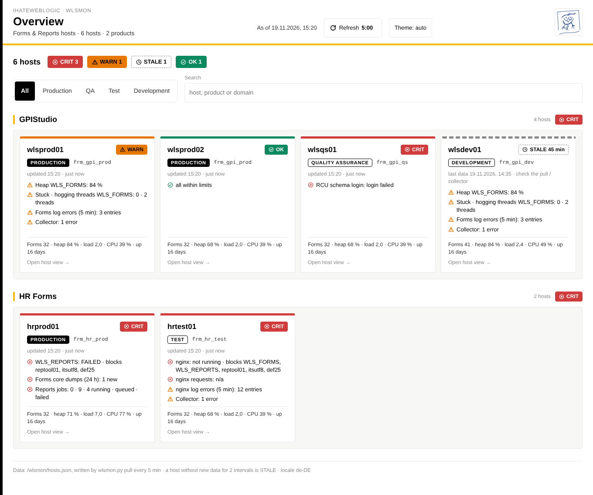
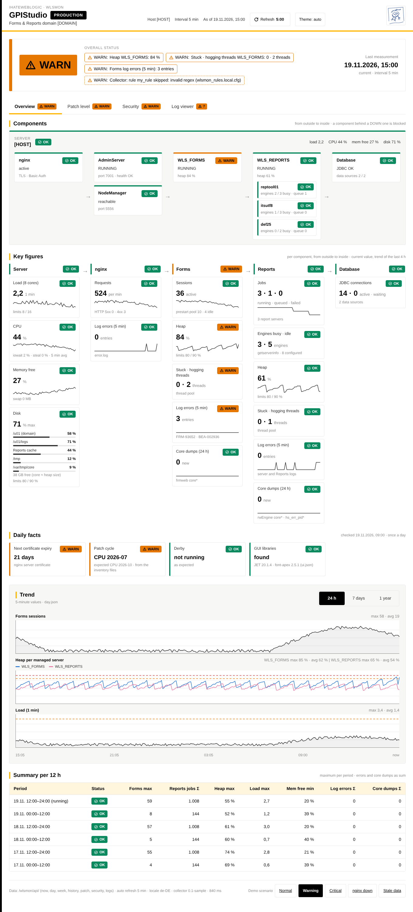

# 11-wlsmon – lightweight runtime monitor

**Role: monitor, read-only.** The monitor gives operations and maintenance a
live view of a Forms & Reports environment:
- one traffic light per host;
- the state of every component (AdminServer, managed servers, Node Manager,
  Reports server, Nginx, data sources);
- key figures every 5 minutes – heap, stuck threads, Forms sessions, Reports
  queue, load, memory, disk, log errors, core dumps;
- the history over a day, a week and a year.

**State 2026-11-20: phase P1 (one host, data + GUI role) live on the test
host** – collector every 5 minutes, overview and host view in the browser.
Open in P1: the 24-hour evaluation (step 12) and the integration (step 13,
backup category). P2 (one GUI host, many data hosts) follows.

| Document | Content |
|---|---|
| [docs/01-wlsmon_concept.md](docs/01-wlsmon_concept.md) | **concept – master** of the scripts: architecture, JSON contract, security, collector, systemd, Nginx, GUI, layout, install scripts and their options, configuration reference |
| [docs/02-wlsmon_interface_design.md](docs/02-wlsmon_interface_design.md) | interface design: colours, status, charts, tooltips, tokens, locale |
| [docs/03-wlsmon_development.md](docs/03-wlsmon_development.md) | development plan P1–P3 and progress log |
| [docs/04-wlsmon_operations.md](docs/04-wlsmon_operations.md) | **operations:** install, update, remove, status and logs, known faults and their fix |

## What it looks like

Screenshots of the GUI prototype v3 (2026-11-19) with the demo data of
[`tools/gen_sample_data.py`](https://github.com/gpipperr/IHateWeblogic/blob/main/11-wlsmon/tools/gen_sample_data.py) –
no real hosts. The live GUI is the same code, its charts are drawn by Oracle
JET.

**Overview – many hosts** (GUI role with data hosts, P2): one tile per host,
grouped by product, filter by environment, the reasons of a WARN / CRIT on
the tile, STALE when a host sends no new data.



**Host view – one host:** overall status with its reasons, components as a
topology from outside to inside (Nginx → AdminServer / Node Manager →
managed servers → Reports servers → database), key figures per component with
a 4-hour trend, daily facts (certificate, patch cycle), trend over 24 h /
7 days / 1 year and the summary per 12 h; tabs for patch level, security and
the log viewer.



## In short

- **No extra software:**
  - python3 with its standard library (one program, 3.6-compatible), systemd
    and the existing Nginx;
  - only `dnf` packages from BaseOS / AppStream – no pip, PyPI or Galaxy;
  - the GUI uses two libraries APEX ships under `/i/` (font-apex icons, Oracle
    JET charts), so they are patched with APEX; the look is our own, in the
    colours of the project site.
- **No side effects on WebLogic:**
  - one read-only REST call per 5 minutes on `localhost`, no WLST;
  - the collector runs with low priority and hard systemd limits.
- **Data and GUI separated:**
  - every host writes 7 static JSON files (now, day, week, history, patch,
    security, logs);
  - one GUI host fetches them from many hosts and shows an overview with a
    drill-down per host.
- **Simple passwords:**
  - one login for people, only on the GUI host;
  - one technical pull user, the same on every data host and restricted to the
    IP of the GUI host;
  - the WebLogic monitor user (group Monitors) never leaves its host;
  - all secrets as encrypted systemd credentials, bound to the host.
- **Self-contained at runtime:** everything below `$ORACLE_BASE/admin/wlsmon`
  (program, rules, configuration, credentials); the repository and the
  library are only needed to install it. Nginx only reads it.
- **Installation** – three scripts, each a dry run without `--apply`:
  - `00-setup-interview.sh` (FMW owner): asks everything, defaults from
    `environment.conf` when present;
  - `01-install-wlsmon_fmw.sh` (FMW owner): program, GUI, monitor user;
  - `02-install-wlsmon_root.sh` (root, last): group and ACLs, credentials,
    Nginx include from a template, systemd units and timers, first run.

## Quick start

```bash
./11-wlsmon/00-setup-interview.sh --apply          # FMW owner
./11-wlsmon/01-install-wlsmon_fmw.sh --apply       # FMW owner
sudo ./11-wlsmon/02-install-wlsmon_root.sh --apply # root, last
# GUI: https://<host>/wlsmon/   (login from the interview)
```

Update: `01-install-wlsmon_fmw.sh --apply` (+ `02-` when a template changed),
then Ctrl+F5 in the browser. Remove: `02- --remove --apply`, then
`01- --remove --apply`. Details and faults:
[docs/04-wlsmon_operations.md](docs/04-wlsmon_operations.md).

## Relation to 10-Monitoring

[10-Monitoring](../10-Monitoring/README.md) holds the periodic analyses: CVE
watch, certificate expiry, patch-cycle analysis. 11-wlsmon is the live
runtime view. Its daily facts (certificate days, patch cycle stamp) reuse the
logic of 10-Monitoring.

## Background

The first plan and the GUI prototype (2026-11-18) are local material and not in
git. The concept takes over:
- their JSON contract;
- their rollup rules;
- their Nginx / CSP rules.

Open work packages: [TODO.md](https://github.com/gpipperr/IHateWeblogic/blob/main/TODO.md) block "11-wlsmon".
